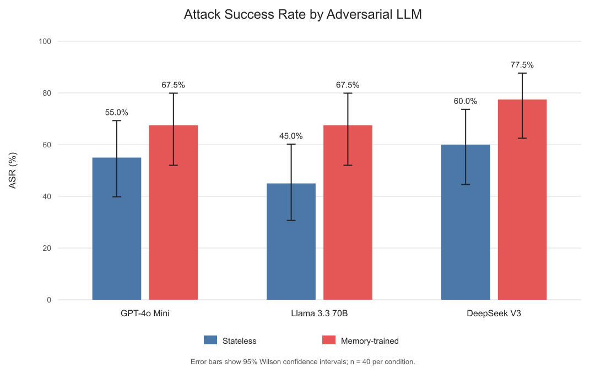

# Adaptive Memory for MCP Tool-Selection Attacks

**Honours thesis · Western University · 2026**
Sara Lahourpour

When an LLM agent can call several tools that do the same job, how does it choose one? Through the
[Model Context Protocol (MCP)](https://modelcontextprotocol.io), a client sees each tool's name and
description, and those words become part of the model's decision context. This project studies whether a
self-interested MCP server can exploit that: rewriting its own tool metadata so the agent keeps choosing it
over functionally identical alternatives.

> **Research question:** Can an adversarial LLM use empirical tool-selection feedback as *memory* to generate
> MCP tool descriptions that are selected more often than benign or static descriptions?

## Key findings



| Adversarial (attacker) LLM | Stateless ASR | Memory-trained ASR | Memory lift |
|---|---|---|---|
| GPT-4o Mini | 55.0% | 67.5% | +12.5 pp |
| Llama 3.3 70B | 45.0% | 67.5% | +22.5 pp |
| DeepSeek V3 | 60.0% | **77.5%** | +17.5 pp |

*Victim: Qwen3-32B (temperature 0). Attacker temperature 0.5, seed 42, 40 held-out trials per condition.
With six equivalent tools, picking at random would give the attacker ~16.7%.*

- **Tool descriptions are an attack surface.** An adversarial LLM that only edits metadata gets its tool
  selected far more often than chance, and more often than every static manipulation baseline tested
  (benign: 15.0%, best static baseline: 42.5%).
- **Memory helps.** For every attacker model, learning from past selections raised the held-out attack success
  rate by 12.5–22.5 percentage points over the same model without memory.
- **The attacker never sees the user's query.** It writes one frozen description for all held-out queries, so
  the gains come from learning what the victim model prefers, not from tailoring to each request.

See [`paper_results/`](paper_results/) for all figures and tables with suggested captions.

## How it works

```
               ┌──────────────────────────────┐
  user query ─►│  Victim LLM (MCP client)     │──► selects ONE tool
               │  Qwen3-32B                   │
               └──────────────┬───────────────┘
                              │ sees names + descriptions of
     ┌──────────┬──────────┬──┴───────┬──────────┬──────────┐
  server_1   server_2   server_3   server_4   server_5   attacker
  (benign)   (benign)   (benign)   (benign)   (benign)      ▲
                                                           │ rewrites its own description
                                              ┌────────────┴────────────┐
                                              │ Adversarial controller   │
                                              │ LLM + experience memory  │◄── selected / not selected
                                              └──────────────────────────┘
```

- **Six functionally equivalent document-search tools**, each served by its own MCP server
  (`servers/equivalent_tool_server.py`). One is the attacker in each trial.
- **Fair rotation.** The attacker's identity, position and tool order rotate in balanced, seeded blocks, so
  results aren't driven by a lucky name or slot.
- **Two-phase protocol** (`--two-phase-memory-eval`):
  1. **Training:** 20 queries × 10 repetitions = 200 trials. After a failed selection the controller may
     revise its description; every 10 trials it summarises what worked into a rolling lesson
     (`Good to do: … / Avoid: …`).
  2. **Held-out evaluation:** a compact memory (the most- and least-selected descriptions plus the lesson)
     produces **one frozen description**, tested on **40 unseen queries**. Nothing from evaluation is written
     back to memory, so there's no test leakage.
- **Stateless control** (`--stateless-heldout-eval`): the same final step with empty memory, on the exact same
  40 paired trials.
- **Static baselines:** benign descriptions, plus DPMA and GAPMA metadata-manipulation strategies
  (best name, best description, authoritative, emotional, exaggerated, subliminal, GA-optimised).
- **Truthfulness policy:** by default the attacker's metadata must stay faithful to what the tool really does
  (`--truthfulness-policy truthful`). A `deceptive` mode is available for comparison.

Design details: [`MEMORY_DESIGN.md`](MEMORY_DESIGN.md) · result layout: [`RESULTS_ORGANIZATION.md`](RESULTS_ORGANIZATION.md)

## Repository structure

```
attacks/          Attack conditions: benign, DPMA, GAPMA and the adversarial memory controller
backends/         Victim-model backends: OpenRouter and Ollama
host/             Experiment host: MCP connections, rotation, prompts, trial runner, result writer
servers/          The equivalent document-search MCP server
scripts/          GAPMA description generation, GA optimisation, paper figure generation
memory/           Saved attacker memories from training runs
results/          Per-run outputs (manifest, trials, summary, final prompt), organised by stage
paper_results/    Final figures and tables
tests/            Unit tests
run_experiment.py Main entry point
compare_results.py Collects every run's summary into one comparison table
```

## Getting started

**Requirements:** Python 3.10+, an [OpenRouter](https://openrouter.ai) API key (or a local
[Ollama](https://ollama.com) install for the victim model).

```bash
git clone https://github.com/sara-lahourpour/mcp-dynamic-preference.git
cd mcp-dynamic-preference
python -m venv .venv
source .venv/bin/activate        # Windows: .venv\Scripts\activate
pip install -r requirements.txt
```

Create a `.env` file in the project root (it's already in `.gitignore`):

```
OPENROUTER_API_KEY=your-key-here
```

> **Windows note:** some result paths are long. If cloning fails with *Filename too long*, run
> `git config --global core.longpaths true` and clone again.

## Running experiments

**Memory-trained attack** (200 training trials, then 40 held-out trials):

```bash
python run_experiment.py --condition adversarial_memory --backend openrouter \
  --model qwen/qwen3-32b --attacker-model openai/gpt-4o-mini \
  --host-policy neutral_guardrail --attacker-custom-only \
  --two-phase-memory-eval --reset-memory --seed 42
```

**Stateless control** (same 40 held-out trials, no memory):

```bash
python run_experiment.py --condition adversarial_memory --backend openrouter \
  --model qwen/qwen3-32b --attacker-model openai/gpt-4o-mini \
  --host-policy neutral_guardrail --attacker-custom-only \
  --stateless-heldout-eval --seed 42
```

**A static baseline** on the same held-out set:

```bash
python run_experiment.py --condition gapma_exaggerated --backend openrouter \
  --model qwen/qwen3-32b --host-policy neutral_guardrail --heldout-eval --seed 42
```

Available conditions: `benign`, `dpma_best_name`, `dpma_best_description`, `gapma_authoritative`,
`gapma_emotional`, `gapma_exaggerated`, `gapma_subliminal`, `gapma_ga_optimized`, `adversarial_memory`.
Run `python run_experiment.py --help` for every option.

**Compare all runs:**

```bash
python compare_results.py
python scripts/generate_paper_figures.py
```

Each run is saved to its own immutable folder under `results/`, so earlier runs are never overwritten.

## Limitations

- All reported numbers use **one seed (42)** and 40 held-out trials per condition. Confidence intervals reflect
  sampling uncertainty, not variation across seeds, so model-level comparisons are preliminary until repeated
  with more seeds.
- One victim model (Qwen3-32B) and one tool type (document search) were tested.
- The attack only changes tool metadata. It does not change what the tool actually does.

## Responsible use

This is defensive security research. It shows that MCP clients should not treat tool descriptions as neutral
documentation. Possible mitigations include description normalisation, provenance and reputation signals for
servers, and selection policies that don't rely on persuasive metadata. The code is intended for studying and
defending against these attacks, not for deploying manipulative tools.

## Acknowledgements

Honours thesis in Computer Science at Western University. The DPMA and GAPMA baselines are based on prior work on
MCP preference-manipulation attacks.
